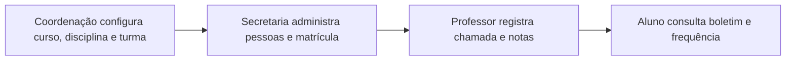

# SGA — Sistema de Gestão Acadêmica

## Escopo da Fase 1

| Metadado | Valor |
| --- | --- |
| Disciplina | Laboratório de Engenharia de Software |
| Professor responsável | Rodrigo Salgado |
| Integrantes do grupo | Andrey Kerges Nascimento, Alexandre Hesse, Max Iago Villafan, João Luiz, Vitor Augusto |
| Versão | **1.0 — MVP Fase 1 concluído** |
| Data | **31 de agosto de 2026** |
| Produto | SGA — Sistema de Gestão Acadêmica |

O SGA é um monólito web para ensino superior. A Fase 1 entrega o ciclo acadêmico essencial: configurar a oferta, administrar contas e matrículas, registrar frequência e notas e permitir a consulta individual pelo aluno.

## Fase 1 concluída

### Perfis e responsabilidades

| Perfil | Responsabilidade entregue |
| --- | --- |
| `ALUNO` | Consulta exclusivamente as próprias matrículas, boletim, médias, situação e frequência. |
| `PROFESSOR` | Consulta suas turmas ativas, registra chamada completa e lança notas nelas. |
| `SECRETARIA` | Cria, edita, lista, ativa/inativa Alunos e Professores; administra matrículas e seus status. |
| `COORDENACAO` | Gerencia cursos, disciplinas e turmas, inclusive alocação de professor. |

### Capacidades do MVP

- Autenticação por sessão, RBAC e troca obrigatória de senha inicial.
- Cursos, disciplinas, turmas, professor responsável, sala, horários e vagas.
- Matrícula administrativa, controle de capacidade, alteração para `TRANCADA`, `CANCELADA` ou `CONCLUIDA` e retentativa somente em outra turma/período.
- Chamada por turma e data, frequência calculada, P1, P2, Trabalho, Exame e situação acadêmica calculada.
- Auditoria imutável de criação e edição de `Nota` e `Falta`.
- Testes automatizados e CI em SQLite e PostgreSQL 16.

## Limites explícitos

Os seguintes itens **não** fazem parte do MVP da Fase 1: auto-matrícula, recuperação de senha, materiais, calendário, comunicados, documentos, transferências, financeiro, aplicativo mobile, integrações externas e pré-requisitos entre disciplinas.

## Roadmap

Esses itens podem ser priorizados em fases futuras, mas não são requisito, entidade, fluxo pronto ou critério de aceite da Fase 1. A evolução deve preservar as entidades e regras já entregues, em especial o histórico de tentativas por turma.

## Documentos relacionados

- [Regras de negócio](SGA-02-REGRAS-DE-NEGOCIO.md)
- [Requisitos](SGA-03-REQUISITOS.md)
- [Modelo de dados](SGA-04-MODELAGEM-DADOS.md)
- [Casos de uso](SGA-06-CASOS-DE-USO.md)

## Estado atual — 20/11/2026

| Fase | Estado | Entregas |
| --- | --- | --- |
| Fase 1/MVP | Concluída | Núcleo acadêmico descrito neste documento. |
| Fase 2 | Concluída | Materiais e comunicados (PR #66), calendário/grade/conflitos (PR #67), relatórios (PR #68, #70), transferências (PR #69, #70), recuperação de senha e notificações (PR #73, ajustes na #75). |
| Fase 3 | Implementada | Pré-requisitos e aproveitamento (PR #76), painel gerencial (PR #77), documentos oficiais (PR #78) e financeiro básico (PR #79), conforme a [especificação da Fase 3](SGA-12-ESPECIFICACAO-FASE-3.md). |
| Estudos | Somente estudo | API pública e integrações ([SGA-13](SGA-13-ESTUDO-API-INTEGRACOES.md)): recomendação de não expor API nesta evolução. App mobile e IA ([SGA-14](SGA-14-ESTUDO-MOBILE-IA.md)): recomendação de não implementar nesta evolução. |
| Fechamento | Em andamento | Documentação final (PR #80), validação com instalação limpa (PR #81) e lacunas da auditoria das issues: comunicados no painel, filtro por turma na grade, testes de vínculo curricular e `CONTRIBUTING.md` (PR #82). Pré-release `v3.0.0-rc1`. Pendentes: conferência visual (#63), ensaio da apresentação (#53), merge em `main` e `v3.0.0`. |

“Fora do MVP” nos trechos da Fase 1 significa fora do escopo **original**, não ausente do código atual. As seções de estado de 08/10/2026 foram substituídas por esta; o histórico permanece no Git.

### Escopo acrescentado pela Fase 3

- **Pré-requisitos e aproveitamento:** Coordenação mantém pré-requisitos por disciplina; a matrícula exige aprovação ou aproveitamento deferido; Secretaria registra e Coordenação analisa aproveitamentos.
- **Painel gerencial:** indicadores agregados, somente leitura, para Coordenação e Secretaria.
- **Documentos oficiais:** declaração de matrícula e histórico escolar com código de verificação e conferência pública.
- **Financeiro básico:** cobranças lançadas pela Secretaria e extrato do aluno, sem meio de pagamento e sem bloqueio acadêmico.

Permanecem fora do escopo: API pública, integrações externas, aplicativo mobile, IA, auto-matrícula e meios de pagamento.
