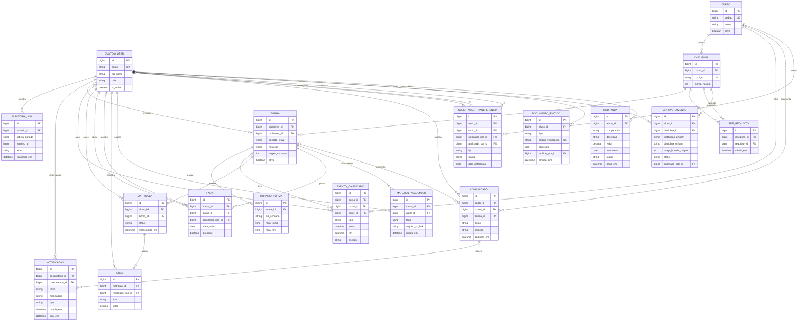

# SGA — Sistema de Gestão Acadêmica

## Modelagem de dados — estado atual

| Metadado | Valor |
| --- | --- |
| Versão | **3.0 — Fases 1, 2 e 3** |
| Data | **20 de novembro de 2026** |
| SGBD | PostgreSQL 16 via Django ORM |

O modelo atual possui **18 entidades persistentes**: o núcleo acadêmico, as extensões da Fase 2 e as quatro entidades da Fase 3 (`PreRequisito`, `Aproveitamento`, `DocumentoEmitido` e `Cobranca`). Aluno e Professor continuam sendo papéis de `CustomUser`, não tabelas separadas. Relatórios e o painel gerencial não possuem entidade própria: são consultas/selectors sobre os registros existentes.

## Entidades atuais

| Entidade | Papel | Principais relações |
| --- | --- | --- |
| `CustomUser` | Usuários e RBAC | autoriza ações; relaciona-se a turmas, matrículas, frequência, notas, auditoria, comunicados, materiais e transferências |
| `AuditoriaLog` | Auditoria imutável | `usuario → CustomUser` |
| `Curso` | Curso acadêmico | possui `Disciplina`; recebe eventos, comunicados e transferências |
| `Disciplina` | Componente curricular | pertence a `Curso`; possui `Turma` |
| `Turma` | Oferta acadêmica | pertence a `Disciplina`; possui professor, horários, matrículas, faltas, materiais, comunicados e eventos |
| `HorarioTurma` | Grade estruturada | pertence a `Turma`; único por turma/dia/início/fim |
| `EventoCalendario` | Calendário | pode apontar para Curso/Turma e papel de destino; possui autor |
| `Matricula` | Tentativa acadêmica | liga Aluno a Turma; preserva histórico por tentativa |
| `Falta` | Frequência | liga Aluno, Turma, data e registrador |
| `Nota` | Avaliação | pertence a `Matricula`; possui tipo e registrador |
| `MaterialAcademico` | Material | pertence a Turma e possui autor; arquivo ou link |
| `Comunicado` | Comunicação | possui autor e escopo geral, papel, curso ou turma |
| `SolicitacaoTransferencia` | Transferência administrativa | liga Aluno e Curso; registra tipo, instituição/curso externos, decisão e auditoria da análise |
| `Notificacao` | Central pessoal | destinatário `CustomUser`, comunicado opcional, categoria, título, mensagem, criação e `lida_em` |
| `PreRequisito` | Pré-requisito curricular | liga duas `Disciplina` do mesmo curso (disciplina → requisito) |
| `Aproveitamento` | Equivalência de disciplina externa | liga Aluno e Disciplina; registra origem, carga, análise e justificativa |
| `DocumentoEmitido` | Documento oficial imutável | liga Aluno e emissor; guarda tipo, código de verificação e conteúdo congelado (JSON) |
| `Cobranca` | Financeiro básico | liga Aluno e quem lançou; competência, valor, vencimento, situação, pagamento e cancelamento |

## MER atual

### Decisões importantes do modelo

- `Matricula` é uma entidade porque representa a tentativa específica do aluno em uma turma. Isso mantém notas e frequência isoladas quando existe retentativa.
- `Nota` pertence a `Matricula`, não diretamente ao aluno, justamente para preservar tentativas.
- `Falta` permanece ligada a Aluno + Turma + data, com unicidade por aula; a chamada exige matrícula ativa.
- `HorarioTurma` estrutura a grade, enquanto `Turma.horarios` permanece como campo textual legado/compatibilidade no modelo atual.
- `EventoCalendario` representa eventos gerais ou segmentados por papel, curso ou turma.
- `MaterialAcademico` exige exatamente um arquivo ou link e aplica limite de 20 MB para arquivo. O arquivo é salvo em uma pasta aleatória (`materiais/<uuid>/<nome>`) e só é entregue pela view `materials:material_download`, que confere o acesso à turma; `MEDIA_URL` não é servido diretamente.
- `Comunicado` possui escopo explícito e valida que somente o alvo correspondente seja preenchido.
- `SolicitacaoTransferencia` é administrativa. Aprovação/recusa não altera automaticamente matrícula, notas ou frequência.
- Relatórios e painel gerencial não têm tabela própria; usam selectors/consultas para evitar duplicação de dados.
- `PreRequisito` usa `PROTECT` nas duas FKs e proíbe autorreferência por constraint; ciclos e mesmo curso são validados no service, com o `Curso` bloqueado durante a alteração.
- `Aproveitamento` segue o padrão de `SolicitacaoTransferencia`: constraint de coerência entre situação e análise e unicidade condicional (pendente/deferido).
- `DocumentoEmitido` guarda o conteúdo congelado em JSON; `save`, `delete` e `update`/`delete` em queryset são bloqueados, como no `AuditoriaLog`.
- `Cobranca` tem valor positivo, coerência de estado (paga ⇔ data de pagamento; cancelada exige justificativa) e unicidade condicional por Aluno + competência + descrição; atraso é derivado, não persistido.

## Integridade e segurança

As FKs históricas e as constraints devem ser interpretadas junto às regras de negócio. O backend aplica RBAC e vínculo com o recurso; esconder botões no template não é mecanismo de segurança. As restrições de unicidade relevantes incluem e-mail, matrícula ativa por Aluno+Turma, nota por Matrícula+tipo, chamada por Turma+Aluno+data e solicitação de transferência pendente equivalente.

`Notificacao` (migration `notifications/0001_initial.py`) tem unicidade de
Comunicado+destinatário e índice de destinatário/leitura/criação; excluir usuário
ou comunicado remove suas notificações por `CASCADE`. Tokens de recuperação são
nativos Django, sem tabela própria.

A Fase 3 acrescenta as migrations `academics/0004_prerequisito_aproveitamento.py`,
`documents/0001_initial.py` e `finance/0001_initial.py`, sem alterar as relações
acadêmicas existentes.

## Referências

- [Regras de negócio](SGA-02-REGRAS-DE-NEGOCIO.md)
- [Requisitos](SGA-03-REQUISITOS.md)
- [Casos de uso](SGA-06-CASOS-DE-USO.md)
- [Transferências](SGA-09-TRANSFERENCIAS.md)
