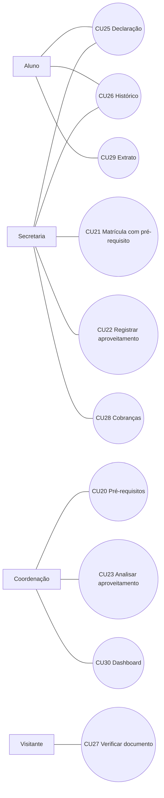
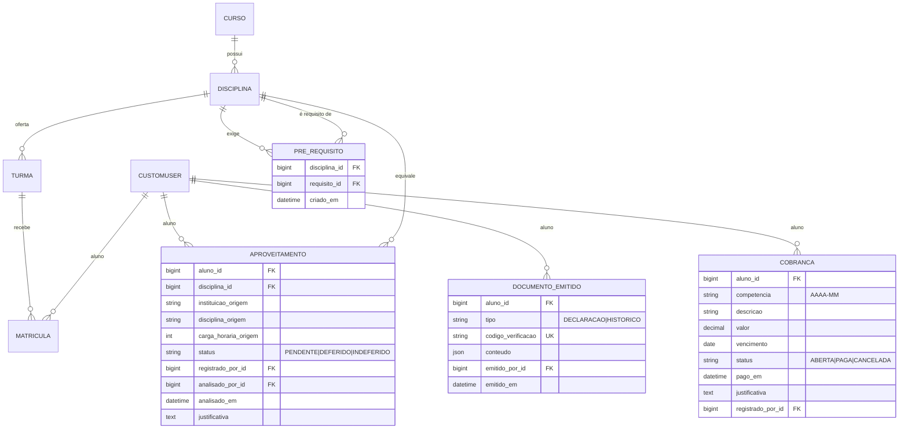

# SGA — Especificação da Fase 3

| Metadado | Valor |
| --- | --- |
| Versão | **0.1 — proposta para revisão da equipe** |
| Data | **29 de outubro de 2026** |
| Issue | #37 — Semana 6: casos de uso, DER e rastreabilidade (João Luiz) |
| Estado | **Nenhum módulo deste documento está implementado na `develop`.** |

## Objetivo

O critério de aceite da #37 exige que as regras complexas sejam documentadas
**antes** da implementação. Este documento define casos de uso, regras, entidades
e rastreabilidade dos quatro módulos da Fase 3, para que os responsáveis
implementem sobre um contrato comum:

| Módulo | Responsável na #37 | Semana |
| --- | --- | --- |
| Pré-requisitos e equivalência de créditos | Alexandre Hesse | 6 |
| Documentos acadêmicos oficiais | Andrey Kerges | 6 |
| Financeiro acadêmico básico | Max Iago | 7 |
| Dashboard gerencial | Max Iago | 7 |
| Auditoria e segurança das novas operações | Vitor Augusto + João Luiz | 7 |

Os identificadores continuam a numeração vigente (RF35, RN17, CU19, RNF06).
Itens marcados **[Decisão]** precisam de confirmação da equipe antes do código.

## Princípios herdados

- Monólito Django, regras em `services.py`, consultas em `selectors.py`,
  permissões por `role_required`/`RoleRequiredMixin` (AGENTS.md).
- Resultado acadêmico **não é persistido**: toda regra que dependa de aprovação
  reutiliza `assessments.selectors.calcular_resultado_academico`.
- Não existe vínculo Aluno–Curso independente de matrícula (SGA-08, SGA-09);
  a Fase 3 não cria esse vínculo.
- Sem novas dependências: documentos usam templates HTML para impressão, como os
  relatórios da Semana 5; dashboard usa tabelas e cards Bootstrap.
- Inativação é preferida à exclusão; FKs históricas usam `PROTECT`.

## Regras de negócio propostas

| ID | Regra |
| --- | --- |
| **RN18** | Uma `Disciplina` pode exigir outras disciplinas **do mesmo curso** como pré-requisito. É proibido autorreferência e ciclo (A → B → A, direto ou indireto). Somente a Coordenação mantém pré-requisitos. |
| **RN19** | A matrícula em turma de disciplina com pré-requisito exige, para **cada** pré-requisito, (a) uma matrícula anterior não cancelada cujo resultado calculado seja `APROVADO_DIRETO` ou `APROVADO_EXAME`, ou (b) um aproveitamento `DEFERIDO`. Matrícula em andamento, reprovação por nota e reprovação por falta não satisfazem o pré-requisito. A verificação ocorre no service de matrícula, dentro da mesma transação. |
| **RN20** | Aproveitamento (equivalência de créditos) é registrado pela Secretaria com instituição, disciplina de origem e carga horária de origem, e analisado pela Coordenação (`DEFERIDO`/`INDEFERIDO`, com justificativa obrigatória). **[Decisão D1]** deferimento exige carga horária de origem ≥ 75% da carga da disciplina. Não há mais de um aproveitamento pendente ou deferido por Aluno + Disciplina. |
| **RN21** | Documentos oficiais (declaração de matrícula e histórico escolar) são gerados a partir dos dados vigentes e registrados em `DocumentoEmitido` com código de verificação único, emissor e momento. O conteúdo emitido é congelado (snapshot) e não muda se os dados acadêmicos mudarem depois. |
| **RN22** | O Aluno emite somente os próprios documentos; a Secretaria emite para qualquer aluno. O histórico lista apenas matrículas com resultado final (aprovado ou reprovado) e aproveitamentos deferidos; matrículas canceladas não aparecem. |
| **RN23** | A verificação pública de documento recebe somente o código e exibe tipo, data de emissão e nome do aluno parcialmente mascarado; não expõe notas, e-mail ou identificadores internos. |
| **RN24** | A Secretaria lança cobranças (`Cobranca`) por aluno e competência (mês/ano), com valor positivo e vencimento; há no máximo uma cobrança não cancelada por Aluno + competência + descrição. Situações: `ABERTA`, `PAGA`, `CANCELADA`. Baixa e cancelamento exigem cobrança `ABERTA`; cancelamento exige justificativa. Atraso é derivado (`ABERTA` e vencimento < hoje), não persistido. |
| **RN25** | O Aluno consulta somente as próprias cobranças. **[Decisão D2]** a situação financeira **não** bloqueia matrícula, notas, frequência nem documentos nesta fase. Não há integração com meio de pagamento, juros ou multa. |
| **RN26** | O dashboard gerencial é somente leitura, restrito à Coordenação (**[Decisão D3]** e à Secretaria). Indicadores são agregados por período letivo e curso, calculados por selectors com número de consultas constante em relação à quantidade de turmas. |
| **RN27** | Criação, alteração de estado e exclusão lógica de `PreRequisito`, `Aproveitamento`, `DocumentoEmitido` e `Cobranca` registram `AuditoriaLog` via `accounts.services.registrar_auditoria`, estendendo RN15. Valores financeiros e decisões de análise entram no `valor_antigo`/`valor_novo`. |

## Requisitos funcionais propostos

| ID | Requisito | Ator |
| --- | --- | --- |
| RF36 | Manter pré-requisitos de disciplina com validação de ciclo | Coordenação |
| RF37 | Bloquear matrícula sem pré-requisito cumprido, informando quais faltam | Secretaria |
| RF38 | Registrar solicitação de aproveitamento | Secretaria |
| RF39 | Analisar aproveitamento (deferir/indeferir) | Coordenação |
| RF40 | Emitir declaração de matrícula | Aluno, Secretaria |
| RF41 | Emitir histórico escolar | Aluno, Secretaria |
| RF42 | Verificar autenticidade de documento por código | Público |
| RF43 | Lançar, baixar e cancelar cobrança | Secretaria |
| RF44 | Consultar extrato financeiro próprio | Aluno |
| RF45 | Consultar dashboard gerencial | Coordenação (Secretaria — D3) |

| ID | Requisito não funcional |
| --- | --- |
| RNF07 | Novas telas respeitam RBAC e retornam 403/404 conforme o padrão atual, cobertos por testes. |
| RNF08 | Listagens paginadas (20 itens) e consultas sem N+1, com teste de número de queries. |
| RNF09 | Constraints condicionais testadas em SQLite e PostgreSQL 16 (CI). |
| RNF10 | Verificação pública com limitação de tentativas por IP, reutilizando o padrão de cache da recuperação de senha. |

## Casos de uso

| Caso | Ator e pré-condições | Fluxo principal | Exceções | Pós-condições | RN |
| --- | --- | --- | --- | --- | --- |
| **CU20 — Manter pré-requisitos** | Coordenação; disciplina ativa. | Seleciona disciplina e adiciona/remove pré-requisitos do mesmo curso. | Autorreferência, ciclo ou outro curso são recusados com mensagem. | Grafo de pré-requisitos acíclico; auditoria registrada. | RN18, RN27 |
| **CU21 — Matricular com pré-requisito** | Secretaria; extensão de CU11. | Ao efetivar matrícula, o sistema verifica cada pré-requisito da disciplina. | Pré-requisito pendente bloqueia e lista as disciplinas faltantes. | Matrícula criada somente se todos os pré-requisitos forem cumpridos. | RN05–RN08, RN19 |
| **CU22 — Registrar aproveitamento** | Secretaria; aluno ativo. | Informa disciplina interna, instituição, disciplina e carga de origem. | Duplicidade pendente/deferida é recusada. | Aproveitamento `PENDENTE`; auditoria. | RN20, RN27 |
| **CU23 — Analisar aproveitamento** | Coordenação; aproveitamento pendente. | Defere ou indefere com justificativa. | Carga insuficiente impede deferimento (D1); decisão repetida é recusada. | Estado final imutável; auditoria. | RN20, RN27 |
| **CU25 — Emitir declaração de matrícula** | Aluno (própria) ou Secretaria; aluno com matrícula ativa. | Sistema gera página para impressão com matrículas ativas e código de verificação. | Sem matrícula ativa: declaração não é emitida. | `DocumentoEmitido` com snapshot. | RN21, RN22, RN27 |
| **CU26 — Emitir histórico escolar** | Aluno (próprio) ou Secretaria. | Sistema lista disciplinas com resultado final, MF/MP, frequência e aproveitamentos deferidos. | Aluno de outro usuário: 404. | `DocumentoEmitido` com snapshot. | RN11–RN14, RN21, RN22 |
| **CU27 — Verificar documento** | Visitante sem login. | Informa código; sistema confirma tipo, data e nome mascarado. | Código inexistente ou excesso de tentativas: mensagem neutra. | Nenhum dado alterado. | RN23 |
| **CU28 — Gerenciar cobranças** | Secretaria; aluno ativo. | Lança cobrança, registra pagamento ou cancela com justificativa. | Cobrança não aberta não muda de estado; duplicidade recusada. | Estado atualizado; auditoria. | RN24, RN27 |
| **CU29 — Consultar extrato** | Aluno autenticado. | Lista as próprias cobranças com situação e atraso derivado. | Cobrança de outro aluno: 404. | Nenhum dado alterado. | RN24, RN25 |
| **CU30 — Consultar dashboard** | Coordenação (D3). | Filtra por período/curso e vê indicadores. | Filtro inválido volta ao padrão; outros papéis: 403. | Nenhum dado alterado. | RN26 |

CU24 fica reservado para uma eventual consulta de aproveitamentos pelo Aluno.

### Indicadores do dashboard (CU30)

| Indicador | Fonte |
| --- | --- |
| Matrículas ativas por curso e período | `Matricula` (`status=ATIVA`) |
| Ocupação de vagas por turma | `contar_vagas_ocupadas` / `vagas_maximas` |
| Aprovação, reprovação por nota, por falta e em exame | `calcular_resultado_academico` sobre as matrículas do filtro |
| Alunos em risco | `academics.selectors.get_relatorio_turmas(risco=...)` |
| Transferências pendentes | `SolicitacaoTransferencia` (`PENDENTE`) |
| Aproveitamentos pendentes | `Aproveitamento` (`PENDENTE`) |
| Cobranças em atraso (quantidade e total) | `Cobranca` (`ABERTA`, vencimento < hoje) |

## DER proposto

Entidades novas em destaque; as demais já existem.

### Restrições de banco

| Entidade | Restrição |
| --- | --- |
| `PreRequisito` | `UniqueConstraint(disciplina, requisito)`; `CheckConstraint(disciplina != requisito)`. Ciclo e mesmo curso validados no service (não expressáveis em constraint). FKs `PROTECT`. |
| `Aproveitamento` | `UniqueConstraint(aluno, disciplina)` condicional a `status in (PENDENTE, DEFERIDO)`; `CheckConstraint` de coerência análise/estado, no mesmo padrão de `SolicitacaoTransferencia`; `carga_horaria_origem > 0`. |
| `DocumentoEmitido` | `codigo_verificacao` único, gerado com `secrets.token_urlsafe`; registro sem update/delete pela aplicação. |
| `Cobranca` | `valor > 0`; `UniqueConstraint(aluno, competencia, descricao)` condicional a `status != CANCELADA`; `CheckConstraint`: `PAGA` ⇔ `pago_em` preenchido; `CANCELADA` exige justificativa. `DecimalField(max_digits=10, decimal_places=2)`. |

**[Decisão D4]** apps novos: `prerequisites` não é necessário — `PreRequisito` e
`Aproveitamento` cabem em `academics`; `DocumentoEmitido` em app `documents`;
`Cobranca` em app `finance`; dashboard em `academics` (selectors) ou app
`dashboard`. Cada app novo exige migração isolada.

## Auditoria e segurança das novas operações (Semana 7)

| Operação | Papel permitido | Auditoria | Riscos e controles | Testes obrigatórios |
| --- | --- | --- | --- | --- |
| Manter pré-requisito | Coordenação | Criar/excluir | Ciclo derrubando matrículas: validação em service com bloqueio | ciclo direto e indireto, outro curso, 403 dos demais papéis |
| Matrícula com pré-requisito | Secretaria | Já coberta pela matrícula | Corrida entre lançamento de nota e matrícula: verificar dentro da transação | aprovado direto/exame aceito; em andamento, reprovado nota/falta, cancelada recusados; aproveitamento deferido aceito |
| Registrar/analisar aproveitamento | Secretaria / Coordenação | Criar / editar | Dupla análise concorrente: `select_for_update` como em transferências | duplicidade, decisão repetida, justificativa vazia, D1 |
| Emitir documento | Aluno (próprio), Secretaria | Criar | IDOR: filtrar por usuário no selector, nunca por ID da URL sozinho | aluno A não emite de B (404), snapshot imutável, código único |
| Verificar documento | Público | Não | Enumeração de códigos e vazamento de dados: código longo aleatório, rate limit, máscara de nome | código inválido neutro, limite de tentativas, ausência de notas/e-mail na resposta |
| Cobranças | Secretaria (escrita), Aluno (leitura própria) | Criar / editar | Alteração indevida de valor pago: estados finais imutáveis | transições inválidas, duplicidade, valor ≤ 0, isolamento do extrato |
| Dashboard | Coordenação (D3) | Não | Exposição de dados pessoais: apenas agregados | 403, número de queries constante, filtros inválidos |

Também na Semana 7: revisar se a `AuditoriaLog` (docstring atual menciona apenas
Nota e Falta) deve ter o texto atualizado para refletir RN27.

## Rastreabilidade

| RF | CU | RN | Entidades / evidência prevista |
| --- | --- | --- | --- |
| RF36 | CU20 | RN18, RN27 | `PreRequisito`, testes de ciclo |
| RF37 | CU21 | RN05–RN08, RN19 | `Matricula`, `PreRequisito`, `Aproveitamento`, `calcular_resultado_academico` |
| RF38 | CU22 | RN20, RN27 | `Aproveitamento`, `AuditoriaLog` |
| RF39 | CU23 | RN20, RN27 | `Aproveitamento`, `AuditoriaLog` |
| RF40 | CU25 | RN21, RN22, RN27 | `DocumentoEmitido`, `Matricula` |
| RF41 | CU26 | RN11–RN14, RN21, RN22 | `DocumentoEmitido`, `Nota`, `Falta`, `Aproveitamento` |
| RF42 | CU27 | RN23 | `DocumentoEmitido`, cache de limitação |
| RF43 | CU28 | RN24, RN27 | `Cobranca`, `AuditoriaLog` |
| RF44 | CU29 | RN24, RN25 | `Cobranca` |
| RF45 | CU30 | RN26 | selectors agregados sobre `Matricula`, `Turma`, `SolicitacaoTransferencia`, `Aproveitamento`, `Cobranca` |

Ao implementar cada módulo, a coluna de evidência deve ser substituída pelos
arquivos e testes reais, e as linhas migradas para SGA-05.

## Decisões pendentes para a equipe

| ID | Decisão | Proposta |
| --- | --- | --- |
| D1 | Critério de deferimento de aproveitamento | Carga de origem ≥ 75% da disciplina |
| D2 | Financeiro bloqueia operações acadêmicas? | Não nesta fase |
| D3 | Secretaria acessa o dashboard? | Sim, somente leitura |
| D4 | Distribuição em apps | `academics` + `documents` + `finance` |
| D5 | Escopo mínimo se o prazo de 08/11 não comportar tudo | Prioridade: pré-requisitos → documentos → dashboard → financeiro |

## Referências

- [Regras de negócio](SGA-02-REGRAS-DE-NEGOCIO.md)
- [Requisitos](SGA-03-REQUISITOS.md)
- [Modelagem de dados](SGA-04-MODELAGEM-DADOS.md)
- [Rastreabilidade](SGA-05-RASTREABILIDADE.md)
- [Casos de uso](SGA-06-CASOS-DE-USO.md)
- [Preparação da Fase 2](SGA-08-PREPARACAO-FASE-2.md)
- [Transferências](SGA-09-TRANSFERENCIAS.md)
- [Estudo de API pública e integrações](SGA-13-ESTUDO-API-INTEGRACOES.md)
