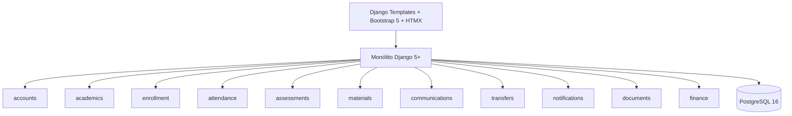
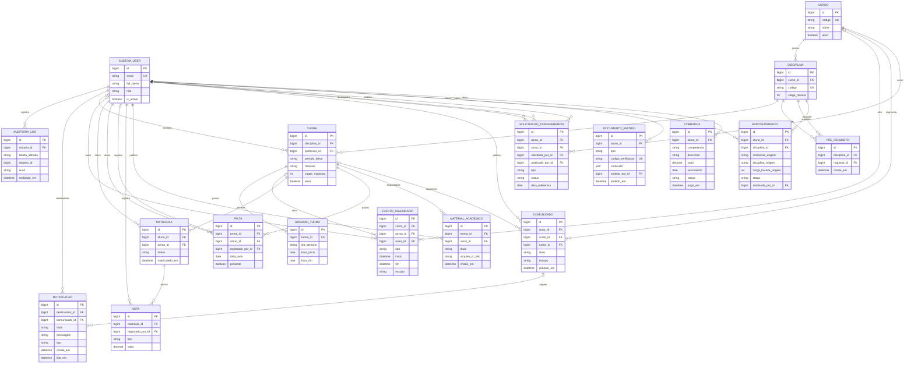

# SGA — Sistema de Gestão Acadêmica

## Documento consolidado

| Metadado | Valor |
| --- | --- |
| Versão | **3.0 — entrega final (Fases 1, 2 e 3)** |
| Data | **20 de novembro de 2026** |

## Resumo

O SGA é um monólito Django para ensino superior, com acesso isolado por papel (Aluno, Professor, Secretaria e Coordenação).

- **Fase 1/MVP:** RBAC, usuários, oferta acadêmica, matrícula administrativa, frequência, notas, cálculos, auditoria e consulta individual do aluno.
- **Fase 2:** materiais e comunicados, calendário/grade/conflitos, transferências, relatórios acadêmicos com risco, recuperação segura de senha e notificações internas.
- **Fase 3:** pré-requisitos e aproveitamento de disciplinas, painel gerencial, documentos oficiais com verificação pública e financeiro básico.
- **Estudos:** API pública e integrações foram estudadas ([SGA-13](SGA-13-ESTUDO-API-INTEGRACOES.md)) e não implementadas, por recomendação. App mobile e IA foram estudados ([SGA-14](SGA-14-ESTUDO-MOBILE-IA.md)) e não implementados, por recomendação.

Os documentos individuais (SGA-01 a SGA-14) são a referência detalhada.

## Escopo e arquitetura



Todos os painéis exibem os comunicados recentes do público do usuário. Regras de negócio ficam em `services.py`, consultas reutilizáveis em `selectors.py` e permissões em decorators/mixins, revalidadas nos services. Operações críticas usam `select_for_update` e compare-and-set; alterações sensíveis geram `AuditoriaLog` imutável. Relatórios e o painel gerencial são consultas, sem entidade própria. A aplicação roda em Docker Compose e é testada com Pytest.

## Perfis

| Papel | Funcionalidades |
| --- | --- |
| `ALUNO` | Painel com comunicados recentes; boletim, situação e frequência próprios; materiais e comunicados; notificações; aproveitamentos e transferências próprios; **Meus Documentos** (declaração e histórico); **Meu Financeiro** (extrato). |
| `PROFESSOR` | Turmas próprias, chamada completa, notas parciais e exame elegível; materiais das próprias turmas. |
| `SECRETARIA` | Usuários Aluno/Professor; matrícula e status (com verificação de pré-requisitos); comunicados; transferências; registro de aproveitamentos; emissão de documentos; cobranças; painel gerencial. |
| `COORDENACAO` | Cursos, disciplinas, turmas, grade (filtros por curso, turma e período) e alocação docente; **pré-requisitos**; análise de transferências e aproveitamentos; relatórios acadêmicos; comunicados; painel gerencial. |
| Visitante | Login, recuperação de senha e verificação pública de documento. |

## Regras centrais

```text
MP = (P1 + P2 + Trabalho) / 3
MP >= 6            => aprovado direto
4 <= MP < 6        => elegível ao exame, se frequência >= 75%
MP < 4             => reprovado por nota
MF = (MP + Exame) / 2; MF >= 6 => aprovado após exame
Frequência < 75%   => reprovado por falta e exame bloqueado
```

Somente a Secretaria efetiva matrícula, e só se cada pré-requisito da disciplina estiver cumprido por aprovação (direta ou após exame) ou aproveitamento deferido. Nova tentativa é feita em outra turma/período, preservando o histórico. Aproveitamento exige carga de origem ≥ 75%. Documentos têm conteúdo congelado e código verificável. A situação financeira não bloqueia operações acadêmicas. Regras completas: RN01–RN17 em [SGA-02](SGA-02-REGRAS-DE-NEGOCIO.md) e RN18–RN27 na mesma página e em [SGA-12](SGA-12-ESPECIFICACAO-FASE-3.md).

## Requisitos e rastreabilidade

Fase 1: RF01–RF04, RF06–RF07, RF10–RF11, RF13–RF17, RF20–RF23 e RF27–RF35. Fase 3: RF36–RF45 e RNF07–RNF10. Detalhes em [SGA-03](SGA-03-REQUISITOS.md); matrizes RF ↔ CU ↔ RN ↔ evidência em [SGA-05](SGA-05-RASTREABILIDADE.md).

## Modelo de dados e MER

O modelo persistente possui **18 entidades** ([SGA-04](SGA-04-MODELAGEM-DADOS.md)): `CustomUser`, `AuditoriaLog`, `Curso`, `Disciplina`, `Turma`, `HorarioTurma`, `EventoCalendario`, `Matricula`, `Falta`, `Nota`, `MaterialAcademico`, `Comunicado`, `SolicitacaoTransferencia`, `Notificacao`, `PreRequisito`, `Aproveitamento`, `DocumentoEmitido` e `Cobranca`. Aluno e Professor são papéis de `CustomUser`. Média, situação, frequência, risco, vagas e atraso financeiro são calculados, não persistidos.



## Casos de uso

CU01–CU19 (Fase 1) em [SGA-06](SGA-06-CASOS-DE-USO.md); fluxos da Fase 2 em SGA-09 a SGA-11; CU20–CU30 (Fase 3) resumidos em SGA-06 e detalhados em [SGA-12](SGA-12-ESPECIFICACAO-FASE-3.md).

## Testes, CI e demonstração

A suíte automatizada cobre regras acadêmicas, permissões (403/404), modelos e constraints, services, views, seed e fluxos integrados de todas as fases. A CI executa `check`, `makemigrations --check --dry-run` e `pytest` em SQLite e PostgreSQL 16, com cobertura mínima de 85%. Na validação final da Fase 3 (20/11/2026) a suíte local registrou **574 testes aprovados e cobertura de 90,79%**.

Para a demonstração, use `docker compose exec web python manage.py seed_demo`; o roteiro final, com os cenários da Fase 3, está em [SGA-07](SGA-07-ROTEIRO-DEMO-E-ENTREGA.md).

## Fases e estado atual — 20/11/2026

| Fase | Estado | Entregas |
| --- | --- | --- |
| Fase 1/MVP | Concluída | Núcleo acadêmico (PRs até #31). |
| Fase 2 | Concluída | Materiais e comunicados (#66), calendário/grade/conflitos (#67), relatórios (#68, #70), transferências (#69, #70), recuperação de senha e notificações (#73, #75). |
| Fase 3 | Implementada | Pré-requisitos e aproveitamento (#76), painel gerencial (#77), documentos oficiais (#78), financeiro básico (#79); especificação em SGA-12. |
| Estudos | Somente estudo | API pública e integrações (SGA-13); app mobile e IA (SGA-14). Nenhum implementado, por recomendação. |
| Fechamento | Em andamento | Documentação (#80), validação com instalação limpa (#81), lacunas da auditoria (#82), conferência visual (#84) e pré-release `v3.0.0-rc1`. Pendentes: ensaio (#53), merge em `main` e `v3.0.0`. |

“Fora do MVP” nos documentos da Fase 1 identifica o escopo original, não ausência no código atual.

## Documentos individuais

- [SGA-01 — Escopo](SGA-01-ESCOPO.md)
- [SGA-02 — Regras de negócio](SGA-02-REGRAS-DE-NEGOCIO.md)
- [SGA-03 — Requisitos](SGA-03-REQUISITOS.md)
- [SGA-04 — Modelagem de dados](SGA-04-MODELAGEM-DADOS.md)
- [SGA-05 — Rastreabilidade](SGA-05-RASTREABILIDADE.md)
- [SGA-06 — Casos de uso](SGA-06-CASOS-DE-USO.md)
- [SGA-07 — Roteiro de demonstração e entrega](SGA-07-ROTEIRO-DEMO-E-ENTREGA.md)
- [SGA-08 — Preparação da Fase 2](SGA-08-PREPARACAO-FASE-2.md)
- [SGA-09 — Transferências](SGA-09-TRANSFERENCIAS.md)
- [SGA-10 — Relatórios e integração](SGA-10-RELATORIOS-INTEGRACAO.md)
- [SGA-11 — Recuperação de senha e notificações](SGA-11-RECUPERACAO-NOTIFICACOES.md)
- [SGA-12 — Especificação da Fase 3](SGA-12-ESPECIFICACAO-FASE-3.md)
- [SGA-13 — Estudo de API pública e integrações](SGA-13-ESTUDO-API-INTEGRACOES.md)
- [SGA-14 — Estudo de app mobile e IA](SGA-14-ESTUDO-MOBILE-IA.md)
- [Como contribuir](../CONTRIBUTING.md)
